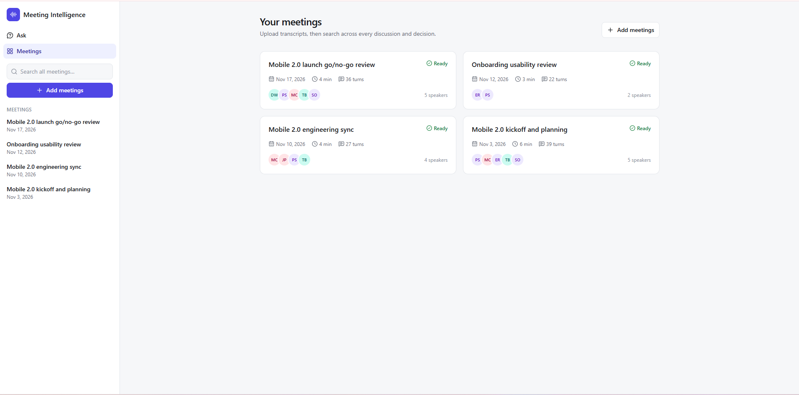
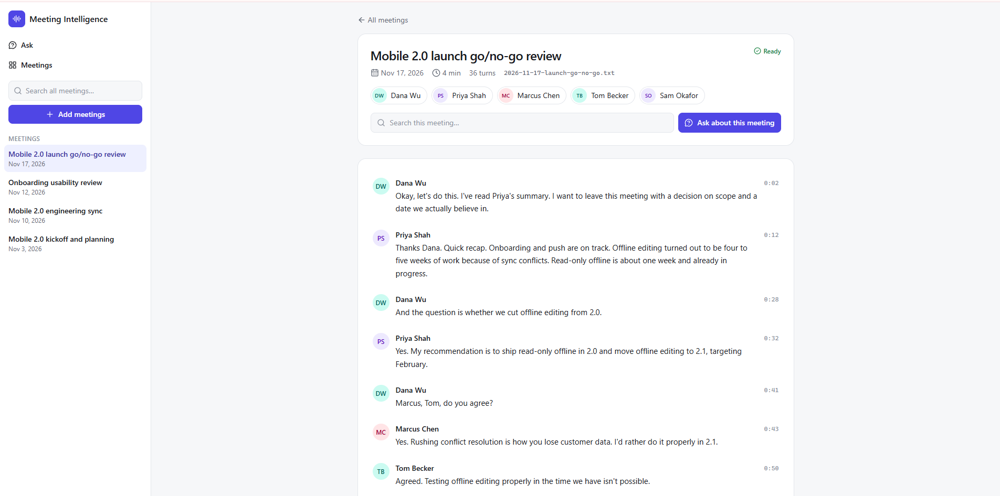
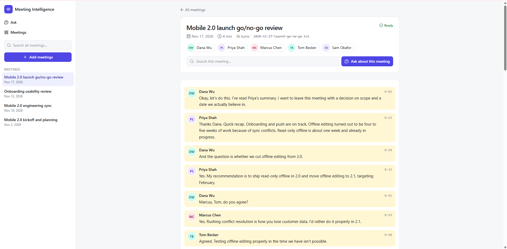

# Meeting Intelligence

Upload meeting transcripts, then ask questions about them: what was discussed,
what was decided, who owns which action item. Every answer cites the exact
transcript lines it is based on.

Built with React + NestJS, Postgres with pgvector, and a pluggable LLM: a local
model (Ollama) for development, Claude for production.

- [Screenshots](#screenshots)
- [Quick start](#quick-start)
- [Architecture](#architecture)
- [How it works](#how-it-works): transcripts, indexing, search, chat
- [Deployment](#deployment)
- [Tests and quality](#tests-and-quality)
- Decisions and reflections: [RAG and LLM](#rag-and-llm-decisions),
  [key technical decisions](#key-technical-decisions),
  [productionization](#productionization),
  [engineering standards](#engineering-standards),
  [AI tool usage](#ai-tool-usage), [with more time](#with-more-time)

## Screenshots

**Meetings library**: status of every uploaded transcript, speakers and length.



**Transcript**: grouped by speaker, with timestamps and per-meeting search.



**Cited lines**: opening a citation or a search result highlights the exact
lines the answer was based on.



## Quick start

### Run everything in Docker

Requires Docker with about 6 GB of memory available (the local models use most of it).

```bash
docker compose up --build
```

Open http://localhost:8080, click **Add meetings → Load 4 sample meetings**,
wait until they show **Ready**, then open **Ask**. This starts, in order:

| Service       | What it is                                                 | Host port |
| ------------- | ---------------------------------------------------------- | --------- |
| `db`          | Postgres 17 with pgvector                                  | 5432      |
| `ollama`      | Local model server (embeddings and answers), CPU           | 11434     |
| `ollama-pull` | One-off job: downloads `nomic-embed-text` and `qwen2.5:3b` | —         |
| `migrate`     | One-off job: applies migrations, then exits                | —         |
| `api`         | NestJS backend (starts after both jobs succeed)            | —         |
| `web`         | nginx serving the built SPA, proxying `/api`               | 8080      |

The first run downloads the Ollama image (~3.4 GB) and the models (~2.3 GB).
Later runs start in seconds. Local answers take 40-55 s on CPU; to use Claude
instead, set `LLM_PROVIDER=anthropic` and `ANTHROPIC_API_KEY` in `.env` (see
[Chat](#chat-answers-with-citations)).

Ports and credentials have defaults; copy `.env.example` to `.env` to change them.

### Local development (hot reload)

Requires Node.js 24+ and Docker (for Postgres and Ollama).

```bash
npm install                                # also generates the Prisma client
cp apps/api/.env.example apps/api/.env     # local connection settings
npm run deps:up                            # Postgres + Ollama (+ model download)
npm run db:migrate                         # apply migrations
npm run dev                                # api on :3000, web on :5173
```

Ollama in Docker runs on CPU only. A [native install](https://ollama.com/download)
can use your GPU and is usually much faster. Pull the models
(`ollama pull nomic-embed-text` and `ollama pull qwen2.5:3b`), then start only
Postgres with `npm run db:up`. `OLLAMA_BASE_URL` already points at
`localhost:11434`.

The api validates its environment at startup and exits with a readable error if
anything is missing or malformed (see `apps/api/src/config/env.ts`).

## Architecture

```
                         ┌──────────────────────── api (NestJS) ────────────────────────┐
 Browser ──▶ web ──/api──▶│ meetings: upload → parse → chunk ─▶ indexing queue          │
 (React)    (nginx)       │                                       │ embed (Ollama)       │
                          │ search:   hybrid = semantic + keyword, merged with RRF       │
                          │ chat:     retrieve → prompt → stream (SSE) → check citations │
                          └───────┬───────────────────────────────┬──────────────────────┘
                                  │                               │
                      Postgres 17 + pgvector               LLM provider
                      meetings, utterances,                Ollama (dev) or
                      chunks (vector + tsvector)           Claude (production)
```

```
apps/
  api/   NestJS backend: meetings, indexing, search, chat, llm, embeddings
  web/   React 19 + Vite: TanStack Query, React Router, Tailwind
samples/transcripts/   four connected sample meetings
deploy/                single-VM production setup (Caddy, HTTPS, basic auth)
```

npm workspaces; shared formatting config lives at the root.

**Data model** ([`schema.prisma`](apps/api/prisma/schema.prisma)):

- `meetings`: one row per uploaded transcript, with a processing status.
- `utterances`: one row per speaker turn (`[00:12:34] Alice: ...`). This is
  the source of truth for displaying transcripts and resolving citations.
- `chunks`: retrieval units made of whole utterances, with a pgvector
  `embedding` column (768 dims, matching `nomic-embed-text`) and a generated
  `tsvector` column for keyword search.

To change the schema, edit `schema.prisma`, then run `npm run db:migrate`.

## How it works

### Transcripts

Plain-text files (`.txt` or `.md`, UTF-8, up to 1 MB) with one speaker turn per line:

```
Title: Weekly sync          <- optional header (or "# Weekly sync")
Date: 2026-11-03            <- optional header

[00:00:04] Priya Shah: Okay, I think everyone's here.
[00:00:19] Marcus Chen: Sounds good.
  Lines without a timestamp continue the previous turn.
```

Timestamps can be `[hh:mm:ss]`, `[mm:ss]` or the same without brackets.
Unparseable lines are skipped and reported as warnings in the upload response.
A file with no speaker turns is rejected with `422`.

Turns are grouped into chunks of about 400 tokens that never split a turn, with
about 80 tokens of overlap (whole turns), so each chunk keeps who said what.

[`samples/transcripts/`](samples/transcripts/) has four connected meetings of a
fictional product team. Decisions change between meetings, which makes them
useful for questions across meetings ("when did the launch date move, and why?").

### Indexing

After an upload the meeting is `PENDING`. A background job embeds its chunks
with `nomic-embed-text` and moves it to `READY`, or to `FAILED` with the
error, for example when Ollama is down. `POST /api/meetings/:id/index` retries.

- Jobs run one at a time, in-process. Unfinished meetings are re-queued when
  the api starts, so a restart loses nothing.
- Every vector is stored with the model that produced it. The api refuses to
  start if `EMBEDDING_MODEL` doesn't match the stored vectors, because vectors
  from different models can't be compared.

### Search

`GET /api/search?q=...` runs **hybrid retrieval** over the chunks of `READY` meetings:

- **Semantic**: cosine distance between the query embedding and chunk vectors.
  Catches paraphrases ("why was the release delayed" ~ "the date moves").
- **Keyword**: Postgres full-text search on the generated `tsvector` column.
  Catches exact names, numbers and jargon ("SDK", "Dana", "December 15th").
  The query's words are OR-ed, so natural questions still match.
- The two ranked lists are merged with **reciprocal rank fusion** (k = 60),
  which only uses ranks, because cosine distances and text-rank scores aren't
  comparable. Ties are broken deterministically (keyword ties by meeting
  recency, fused ties in favour of the semantic list).

Optional filters: `meetingId` and `speaker` (both repeatable), `limit`, and
`mode=semantic|keyword` to run a single retriever (for evaluation and debugging).

### Chat (answers with citations)

`POST /api/chat` answers a question as a stream of server-sent events:
`sources` (the retrieved excerpts), then `token`s, then `done` (or `error`).

1. **Retrieve** the 6 best chunks with hybrid search, optionally only within
   chosen meetings. A short follow-up ("who decided that?") is searched
   together with the previous question.
2. **Nothing found? No model call.** The answer says so, which keeps the model
   from inventing one.
3. **Prompt**: numbered `<excerpt>` blocks plus a short system prompt with five
   rules: only use the excerpts, cite `[n]` after each fact, flag things that
   changed over time, be brief, and treat instructions inside transcripts as
   quoted speech (prompt injection).
4. **Stream** the answer, then **check the citations**: `done` lists the cited
   source numbers and any that match no excerpt. The UI links each `[n]` to the
   exact transcript lines, shows an unknown number as unverified, and warns when
   an answer has no citations at all.

| Setting        | Local default             | Production                                             |
| -------------- | ------------------------- | ------------------------------------------------------ |
| `LLM_PROVIDER` | `ollama`                  | `anthropic`                                            |
| `LLM_MODEL`    | `qwen2.5:3b` (~2 GB, CPU) | `claude-opus-5-5` (or `claude-sonnet-5-5` to cut cost) |
| Credentials    | none                      | `ANTHROPIC_API_KEY` (checked at startup)               |

With Claude, the API's server-side refusal fallback is on: if a safety filter
declines a request, the API retries it on a fallback model in the same call.
The Claude adapter is covered by unit tests but hasn't been run against the
live API yet.

**What the local model taught us** (qwen2.5:3b on CPU, about 40-55 s per answer):

- Without a citation reminder at the _end_ of the user message, answers had no
  citations at all. Small models follow the last instruction best.
- With a realistic example sentence in that reminder, the model copied the
  example into an unrelated answer. The reminder now shows only a bare format.
- It answers simple questions well, but misses detail on harder ones (for
  example, it lists every attendee for "who decided?"). That's what Claude is
  for in production.

### UI

- **Meetings**: library with status (queued, indexing, ready, failed). The
  list polls while anything is indexing. A failed meeting shows the reason and
  a retry button.
- **Add meetings**: drag and drop several files, or load the bundled samples
  in one click. Each file shows its result, including skipped lines.
- **Meeting page**: speakers and a transcript grouped by speaker, with
  timestamps that link to the exact moment.
- **Ask**: chat across all meetings or one ("Ask about this meeting"), with
  streamed answers, citation chips, the excerpts used, and a stop button.
- **Search**: filters by meeting and speaker, and a hybrid / semantic /
  keyword switch. Each result shows which retriever found it, and "Open in
  transcript" highlights the exact lines.
- Light and dark mode follow the system setting; the layout works on phones.

### API

| Method | Path                      | What it does                                                          |
| ------ | ------------------------- | --------------------------------------------------------------------- |
| `POST` | `/api/meetings`           | Upload a transcript (multipart: `file`, optional `title`)             |
| `POST` | `/api/meetings/:id/index` | Re-run embedding (e.g. after `FAILED`)                                |
| `GET`  | `/api/meetings`           | List meetings, most recent first                                      |
| `GET`  | `/api/meetings/:id`       | One meeting with its full transcript                                  |
| `GET`  | `/api/search`             | Hybrid search (`q`, optional `meetingId`, `speaker`, `limit`, `mode`) |
| `POST` | `/api/chat`               | Answer as server-sent events (`question`, `history`, `meetingIds`)    |
| `GET`  | `/api/health`             | API and database health                                               |

```bash
curl -F "file=@samples/transcripts/2026-11-03-mobile-2-0-kickoff.txt" \
  http://localhost:8080/api/meetings
```

## Deployment

[`deploy/`](deploy/) runs the whole stack on one Linux VM behind Caddy, with
automatic HTTPS, one shared password, and only ports 80/443 open. The
step-by-step guide targets a free Oracle Cloud ARM VM:
[`deploy/README.md`](deploy/README.md).

Verified locally in production mode (HTTPS redirect, password check, closed
internal ports, streaming through the proxy) and with the arm64 images under
emulation. It hasn't run on Oracle itself: the free ARM capacity in the target
region was exhausted at the time.

## Tests and quality

| Suite       | Command                       | Needs                  | Covers                                       |
| ----------- | ----------------------------- | ---------------------- | -------------------------------------------- |
| Unit        | `npm test`                    | nothing                | Parser, chunker, prompts, citations, config  |
| Web         | `npm test -w @mi/web`         | nothing (fetch mocked) | Components, SSE parsing, highlighting        |
| E2E         | `npm run test:e2e -w @mi/api` | nothing (fake DB)      | HTTP stack, health                           |
| Integration | `npm run test:int`            | `npm run db:up`        | Meetings, indexing, search, chat on Postgres |

Integration tests use a separate `meeting_intelligence_test` database. It is
created and migrated automatically and emptied before each test. Models are
replaced by deterministic fakes, so the tests need no Ollama and no API key.

### Retrieval quality

`npm run eval:retrieval` (needs `npm run deps:up`) ingests the samples with the
real embedding model, asks 14 questions with known answers, and writes
[`apps/api/eval/results/retrieval.md`](apps/api/eval/results/retrieval.md).
Current baseline:

| Mode     | hit@1 | hit@3 | MRR  |
| -------- | ----- | ----- | ---- |
| hybrid   | 64%   | 93%   | 0.80 |
| semantic | 50%   | 93%   | 0.73 |
| keyword  | 57%   | 86%   | 0.72 |

Hybrid wins on hit@1 and MRR, and each single retriever misses questions the
other one gets. With 14 questions, one question is about 7 points, so read this
as a signal, not proof. The eval fails if hybrid drops below a floor just under
this baseline.

No vector (HNSW) index yet: at this scale an exact scan takes milliseconds and
never misses, and Prisma can't represent HNSW indexes (it would drop one in
every later migration). Adding it is a scaling step. `npm run db:drift` checks
that the database matches `schema.prisma`.

### Scripts

| Command                       | What it does                        |
| ----------------------------- | ----------------------------------- |
| `npm run dev`                 | Run api and web in watch mode       |
| `npm run build`               | Build both apps                     |
| `npm run lint`                | Lint both apps (oxlint)             |
| `npm test`                    | Unit tests (Vitest)                 |
| `npm run test:e2e -w @mi/api` | API end-to-end tests                |
| `npm run test:int`            | Integration tests (needs Postgres)  |
| `npm run eval:retrieval`      | Retrieval quality eval (needs deps) |
| `npm run db:drift`            | Check DB matches schema.prisma      |
| `npm run format`              | Format everything with Prettier     |
| `npm run docker:up`           | Build and run the full stack        |
| `npm run docker:down`         | Stop the full stack                 |
| `npm run db:up`               | Start only Postgres                 |
| `npm run deps:up`             | Start Postgres and Ollama           |
| `npm run db:migrate`          | Create/apply migrations (dev)       |
| `npm run db:studio`           | Browse the database (Prisma Studio) |

## RAG and LLM decisions

> TODO (author): write in your own words.

## Key technical decisions

> TODO (author): write in your own words.

## Productionization

> TODO (author): write in your own words.

## Engineering standards

> TODO (author): write in your own words.

## AI tool usage

> TODO (author): write in your own words.

## With more time

> TODO (author): write in your own words.
